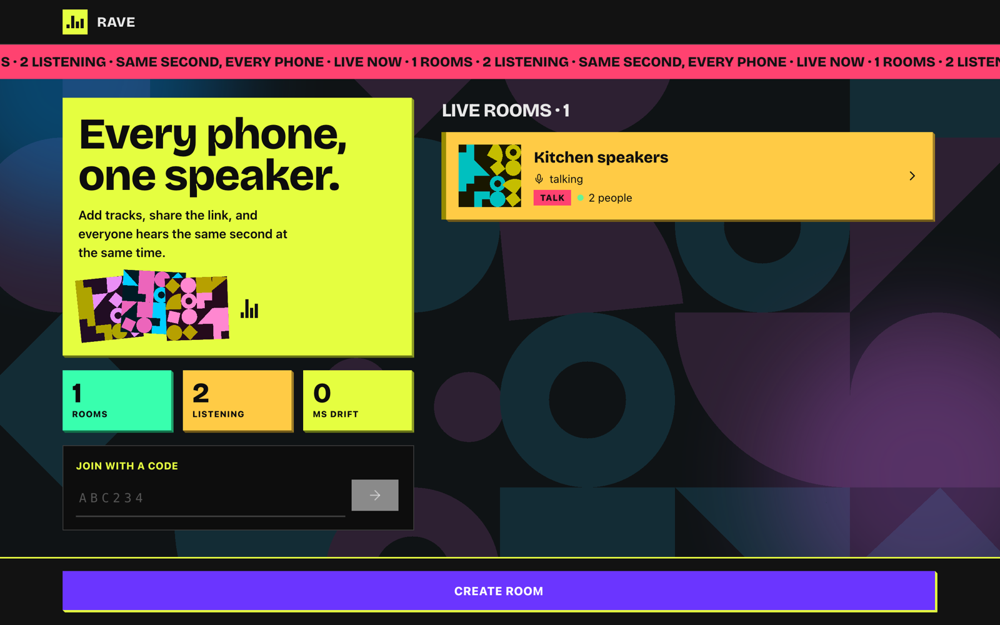
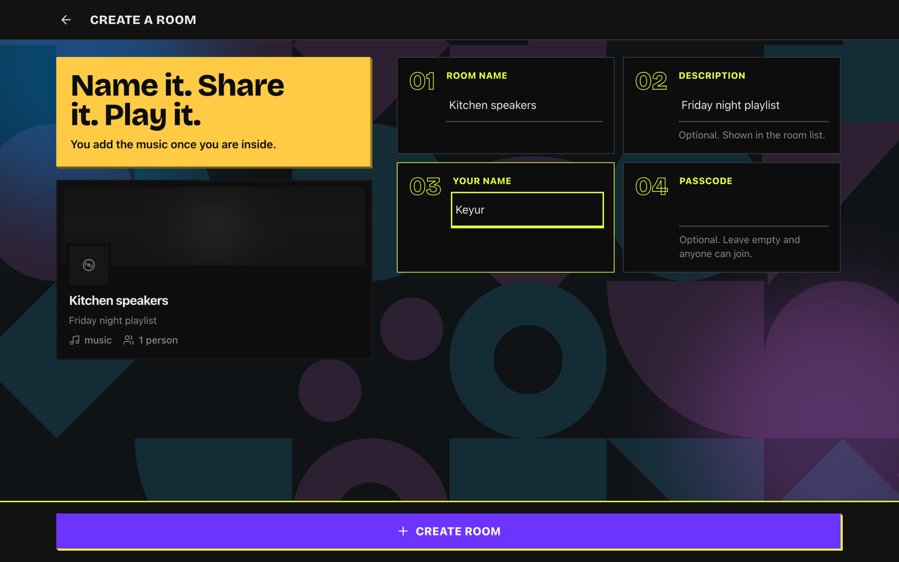
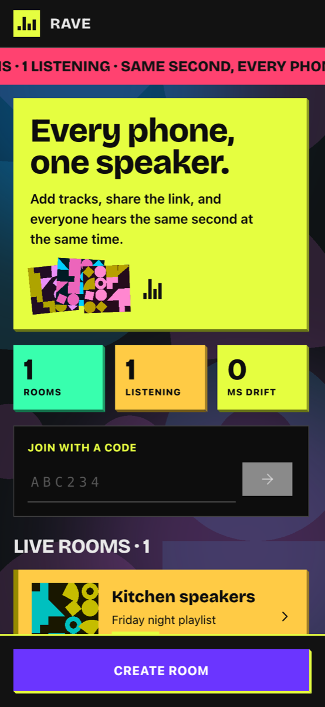
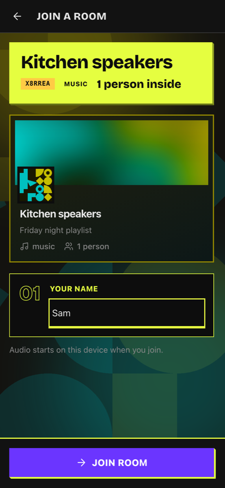
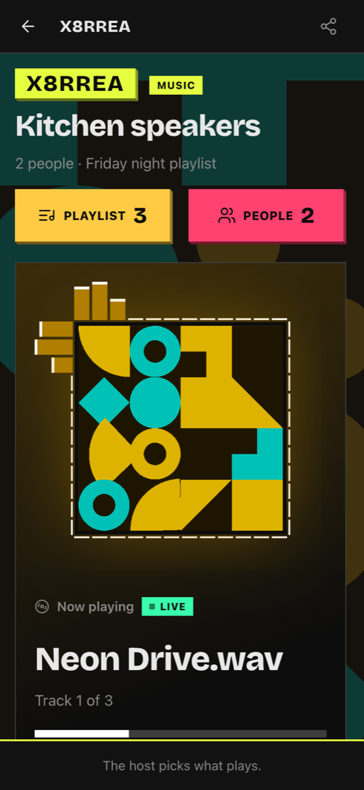
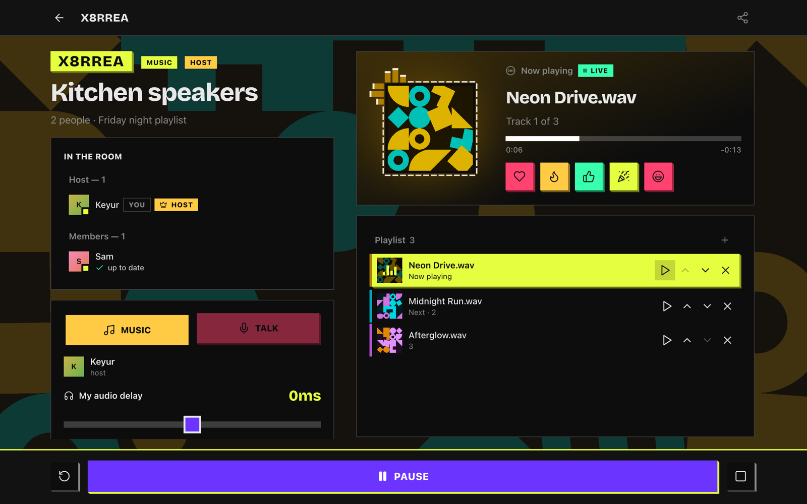
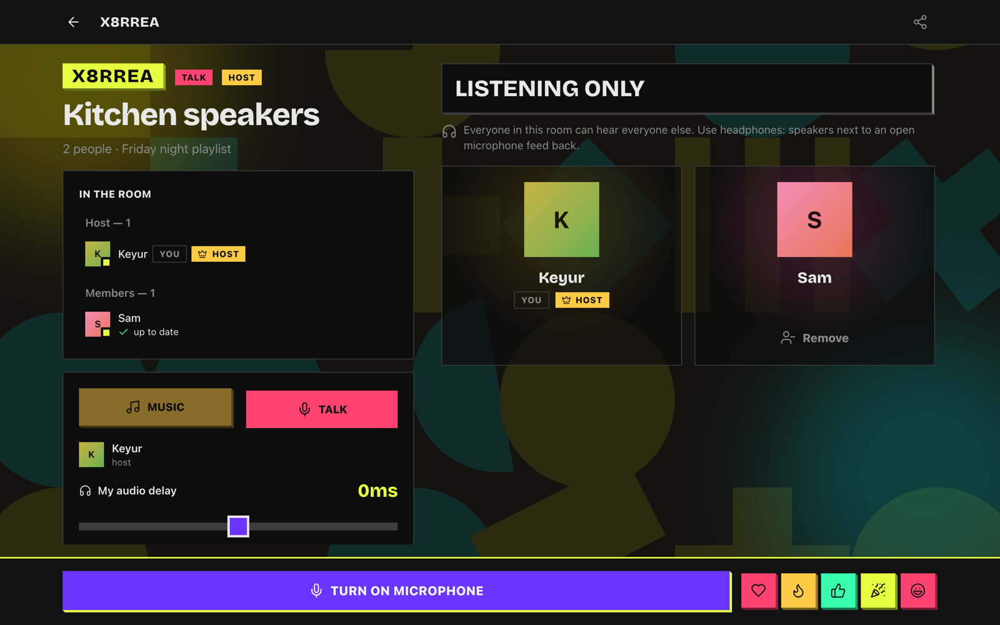
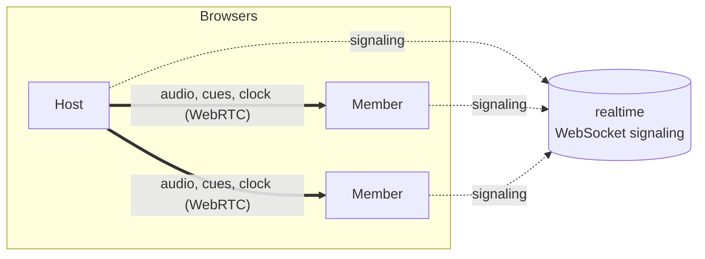

<h1 align="center">Rave</h1>

<p align="center">
  <b>Every phone, one speaker.</b><br>
  Synchronized peer-to-peer audio rooms: add tracks, share a code, and every device plays the same track at the same instant.
</p>

## Contents

- [What it does](#what-it-does)
- [Quick start](#quick-start)
- [Configuration](#configuration)
- [How it works](#how-it-works)
- [Project layout](#project-layout)
- [Development](#development)
- [Known limits](#known-limits)

## What it does

### Open a room

Someone names a room, gives it a display name and an optional passcode, and it is live. Everyone
else sees it on the home screen with who is in it and what is playing, or types the room code.

<p>
  
  
</p>

### Join from anywhere

Join from the room list, with a code, or by link. There is no lock, no size cap and no ready
barrier, so a latecomer drops in already in sync. It works the same on a phone, with one column,
a screen wake lock and a per-device audio delay for Bluetooth speakers.

<p>
  
  
  
</p>

### Play the same track at the same instant

The host adds tracks and runs the playlist. Audio goes peer to peer over WebRTC data channels, so
the server never sees it, and a shared clock keeps every device in step. Cover art is read from
the file, or generated from the title, and the room takes its colours from the current cover.

<p align="center">
  
</p>

### Switch to talk mode

The host can flip the room to talk mode, where everyone can speak to everyone, with a tile per
person and a ring around whoever is speaking. The playlist is kept for when the music comes back.

<p align="center">
  
</p>

## Quick start

Requires Docker, Node.js 20.9 or newer, and pnpm 10.6.1.

```sh
pnpm install
make dev
```

`make dev` starts the dev stack with hot reload, behind Caddy over HTTPS on your LAN address.

| Command | What it does |
|---|---|
| `make dev` | Dev stack with hot reload |
| `make up` | Production stack; prints the URL and a QR code |
| `make down` | Stop the stack |
| `make ca` | Export Caddy's certificate to trust on phones |
| `make logs` | Follow service logs |
| `make help` | List every target |

> [!IMPORTANT]
> HTTPS is required, not optional: WebRTC and wake locks need a secure context. Caddy issues the
> certificate from its own internal CA, so install the one from `make ca` on each phone before
> opening the URL.

## Configuration

Settings are environment variables on the `realtime` service. Put them in a git-ignored `.env`
at the repo root; `docker compose` reads it automatically. Copy [.env.example](.env.example) to start.

| Variable | Default | Purpose |
|---|---|---|
| `ICE_SERVERS` | `stun:stun.l.google.com:19302` | Comma-separated STUN URLs sent to browsers. Empty means host candidates only. |
| `CF_TURN_KEY_ID` | empty | Cloudflare TURN key ID. |
| `CF_TURN_API_TOKEN` | empty | Cloudflare TURN API token. |

When both Cloudflare values are set, `realtime` fetches short-lived TURN credentials (24 hour TTL,
refreshed at half-life) and sends them instead of `ICE_SERVERS`. If Cloudflare is unreachable it
falls back to the static list. Create a key under Cloudflare dashboard → Realtime → TURN.

## How it works



- **Signaling.** Browsers connect to `realtime` over WebSocket to create and join rooms and to
  exchange SDP and ICE. The server holds rooms in memory and relays `signal` messages without
  reading them.
- **Topology.** In music mode members connect only to the host ([ADR 0002](docs/adr/0002-members-connect-only-to-the-creator.md)).
  In talk mode everyone connects to everyone ([ADR 0004](docs/adr/0004-talk-mode-connects-everyone-to-everyone.md)).
- **Starting a track.** The host selects it so every device decodes it, then cues play at its own
  clock plus 500 ms. Each member converts that instant with its measured clock offset and
  schedules the start on the audio clock.
- **Staying in sync.** The clock offset is re-measured every 5 seconds. Every 10 seconds a playing
  device checks itself against the shared clock: within 5 ms it is left alone, up to 100 ms it is
  nudged by 0.2% playback rate, beyond that it reseeks.
- **Tracks.** Held encoded on every device and decoded only when played ([ADR 0003](docs/adr/0003-tracks-held-encoded-decoded-on-play.md)).
  A late joiner picks up in sync ([ADR 0001](docs/adr/0001-late-join-replaces-the-ready-barrier.md)).

## Project layout

A pnpm workspace of three packages.

| Package | Path | What it is |
|---|---|---|
| `@rave/protocol` | [packages/protocol](packages/protocol/src/index.ts) | zod wire schemas shared by browser and server |
| `@rave/realtime` | [apps/realtime](apps/realtime/src) | WebSocket server (`ws`) at `/ws`, plus `/healthz` and `/metrics` |
| `@rave/web` | [apps/web](apps/web/src) | Next.js 16 app (React 19, React Compiler, Tailwind 4), served standalone |

Further reading: [CONTEXT.md](CONTEXT.md) for how the system behaves, [GLOSSARY.md](GLOSSARY.md)
for the vocabulary, and [docs/adr/](docs/adr/) for the decisions behind the shape.

## Development

```sh
make test        # tests in every package
make lint        # lint in every package
make typecheck   # typecheck in every package
```

Add `?debug=1` to a room URL to show the debug overlay.

## Known limits

- Rooms live in one process's memory. A restart ends them all, and there is one `realtime` instance.
- The host's device and uplink carry every transfer, so a very large room is limited by that one device.
- Talk mode is a connection per pair of people, so large talk rooms strain phones.
- Without TURN credentials, peers that cannot reach each other directly cannot join.
- Browsers cannot measure Bluetooth output delay; the audio delay slider is the only correction.
